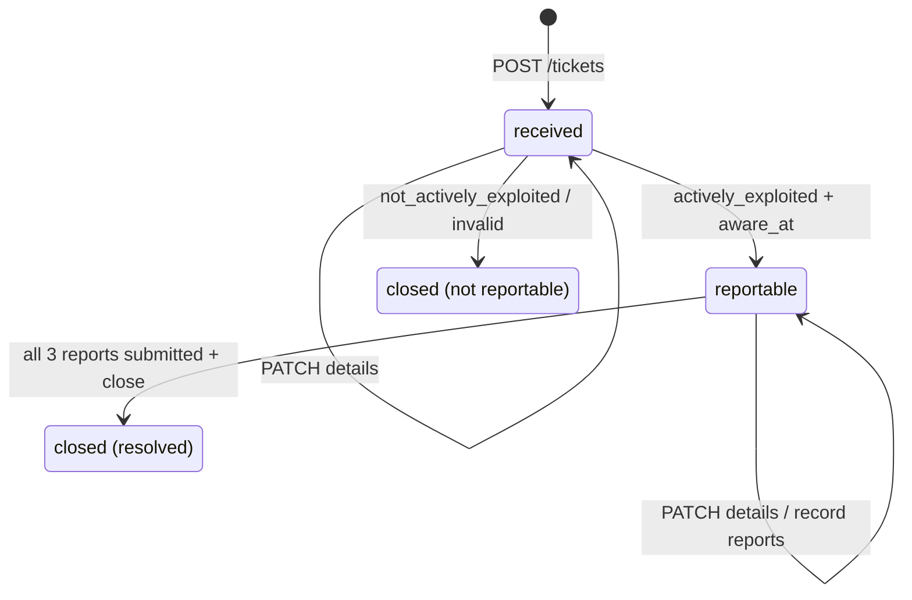
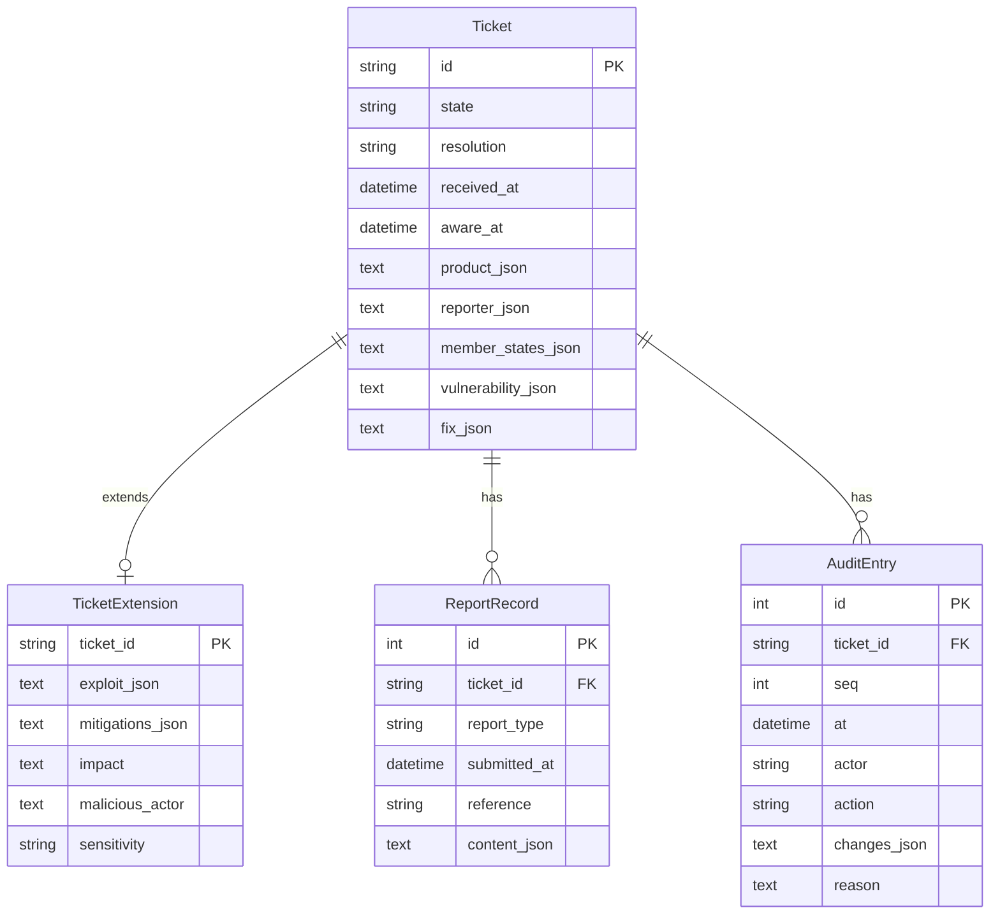
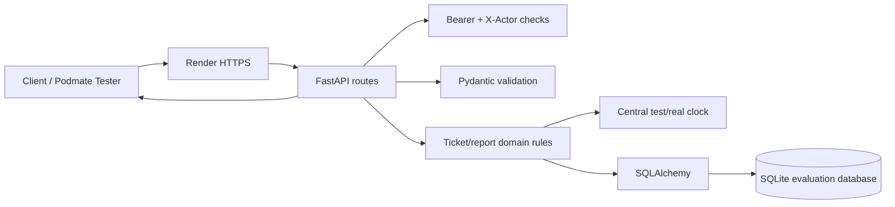

# Phase 4 system models

These models describe the Team 21 implementation delivered for Phase 4. They replace the
Phase 3-only diagram for the Phase 4 submission.

## Model A — Ticket lifecycle



A human makes the actively-exploited decision. The service automates the consequences:
state transitions, deadlines, report status, draft generation, submission records, and closure.

## Model B — Report status

For a reportable or resolved ticket, status is derived on every read rather than stored.

```text
No submission:
  final report + no corrective/mitigating measure -> awaiting_fix
  now <= due_at                              -> pending
  now > due_at                               -> overdue

Submission recorded:
  submitted_at <= recalculated due_at        -> submitted
  submitted_at > recalculated due_at         -> submitted_late
```

Because status is derived, correcting `aware_at` or `fix.available_at` immediately
re-evaluates whether an existing submission was on time.

## Model C — Draft data

All four drafts contain `ticket_id` and `aware_at`. Reporter identity is never copied
into a draft.

| Field | Early warning | Notification | Final report | User advisory |
|---|---|---|---|---|
| product | required | required | required | required |
| affected versions | required | required | required | required |
| member states | required | required | required | not included |
| vulnerability description | — | required | required | required |
| exploit description | — | required | required | — |
| mitigations taken | — | required | required | — |
| mitigations for users | — | required | required | required |
| sensitivity | — | required | required | — |
| severity + impact | — | — | required | optional |
| malicious actor | — | — | optional | — |
| corrective/mitigating measure | — | — | required | optional |

A successful Article 14 submission stores a content snapshot. Later ticket edits do not
change that locked report.

## Data model



The extension table was added so the Phase 4 fields could be persisted without an unsafe
in-place migration of the existing SQLite `tickets` table.

## Architecture / request flow



Phase 4 adds report drafting, submission snapshots, filtering, closure and audit behavior
inside the existing route/domain/database flow. PostgreSQL and durable restart persistence
remain Phase 5 work.
