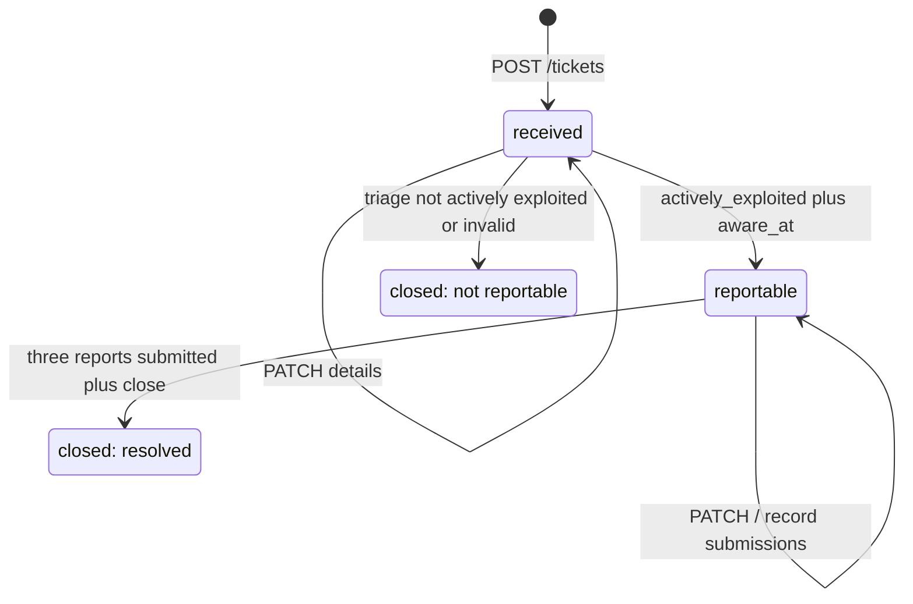
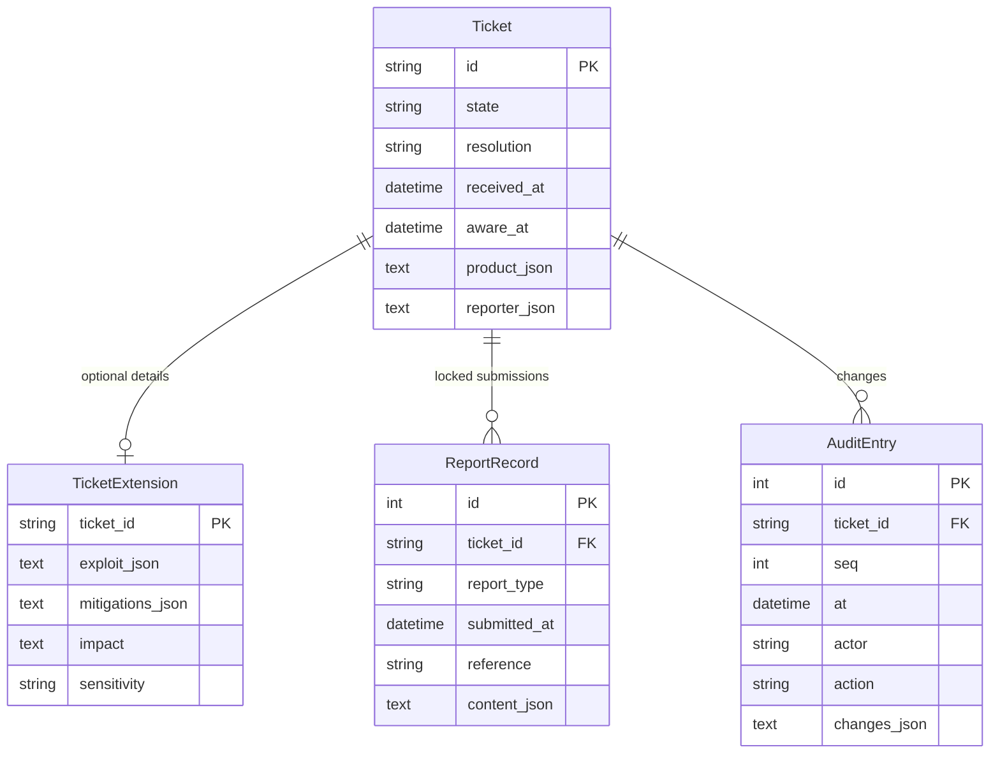
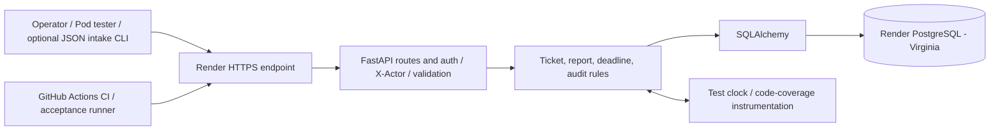

# Team 21 — Phase 5 as-delivered system models

ECE 30861 · Pod K · Team 21 · November 22, 2026. These diagrams describe commit `d83ec6f`, the Phase 5 acceptance-tested deployed system. GitHub renders Mermaid diagrams below as figures. For Gradescope **Q5.1**, link to this page and reference Models A–E.

## Model A — Ticket lifecycle

A closed ticket rejects edits and remains readable. Resolved ticket drafts and locked report snapshots remain readable. Source: `app/routes/tickets.py`.

## Model B — Calculated report status

| Recorded submission? | Condition | Derived status |
|---|---|---|
| No | Final report and corrective measure not yet available | `awaiting_fix` |
| No | Current clock time at/before due time | `pending` |
| No | Current clock time after due time | `overdue` |
| Yes | Submitted time at/before currently calculated deadline | `submitted` |
| Yes | Submitted time after currently calculated deadline | `submitted_late` |

Deadlines and statuses are calculated at read time and are not stored as mutable status records. This preserves the Phase 2/4 model.

## Model C — Required draft fields

The **four draft types** are early warning, notification, final report and user advisory. All contain `ticket_id`, product information, and `aware_at`; reporter identity is excluded. Member States are required in the first three, but not the advisory. Notification and final report include vulnerability/exploit details and mitigations; final report also includes severity, impact and corrective or mitigating measures. The detailed Model C required-field matrix is in [Phase 4 models](phase4-models.md), which remains valid for Phase 5.

## Model D — Persisted entities (ER)

Entities and relationships correspond to [app/models.py](../app/models.py). The canonical web service uses SQLAlchemy and Render-managed **PostgreSQL** for durable ticket, recorded report, and audit data. The fixed evaluation clock and in-process tester sessions are not represented as durable records.

## Model E — Phase 5 deployment and data flow

The API and separately hosted tester are two FastAPI applications. The JSON intake CLI sends requests through the existing `POST /tickets` route; it is not a separate persistence service. CI can run on GitHub while the canonical API remains hosted on Render.

## Phase 5 design requirements and model validation

| Requirement | Delivered model element | Evidence |
|---|---|---|
| DR-01 durable data | Model D / PostgreSQL | AC-19 prepare, web redeploy, verify |
| DR-02 instrumented coverage | Model E / API test instrumentation | `tests/test_phase5.py` and self-test code 288/978 |
| DR-03 coverage measures | Model E / Team 21 tester | 18/18 self-test; model coverage 3/4 |
| DR-04 1,000-ticket performance | Model E / list endpoint + runner | AC-18 self-test p95 0.289s; 200 requests |

Sources: [Phase 5 design requirements](phase5-design.md), [SQLAlchemy models](../app/models.py), [Pod K common OpenAPI 0.3.0](https://github.com/team17-ece30861/pod-k-shared/blob/main/openapi.yaml).
