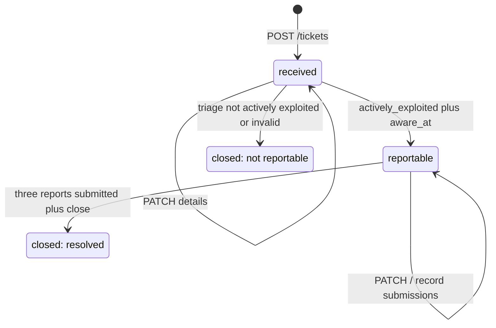
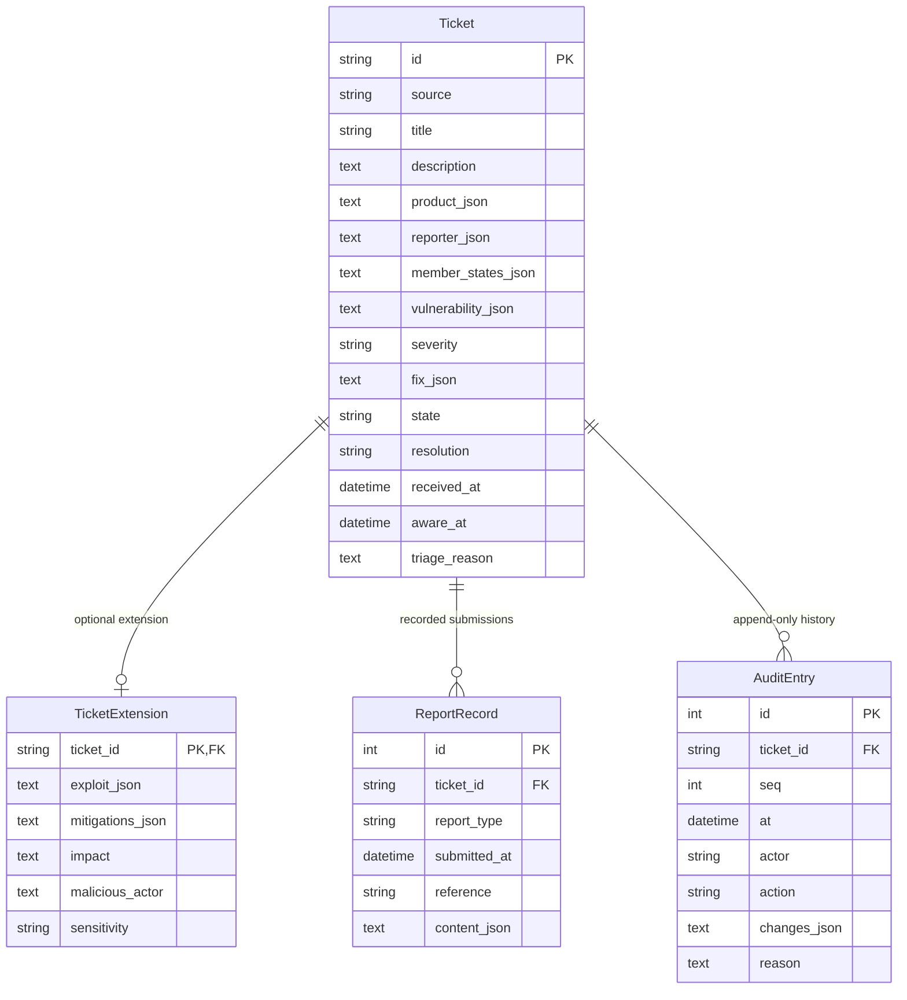
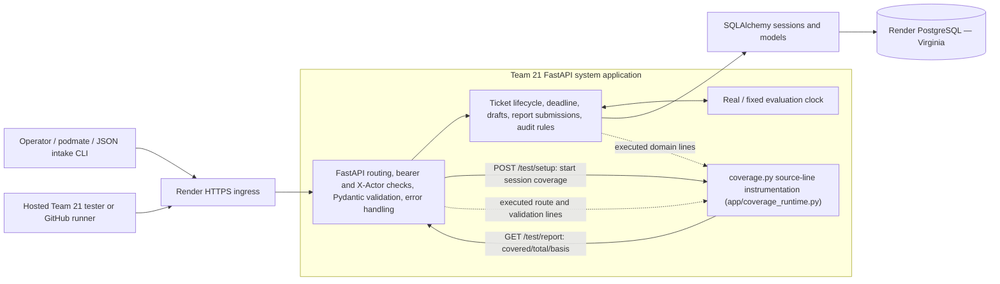

# Team 21 — Phase 5 as-delivered system models

ECE 30861 · Pod K · Team 21 · November 22, 2026. These diagrams describe commit `d83ec6f`, the Phase 5 acceptance-tested deployed system. GitHub renders Mermaid diagrams below as figures. For Gradescope **Q5.1**, link to this page and reference Models A–E.

## Model A — Ticket lifecycle

A closed ticket rejects edits and remains readable. Resolved ticket drafts and locked report snapshots remain readable. Source: `app/routes/tickets.py`.

## Model B — Calculated report status

| Recorded submission? | Condition | Derived status |
|---|---|---|
| No | Final report and corrective measure not yet available | `awaiting_fix` |
| No | Current clock time at/before due time | `pending` |
| No | Current clock time after due time | `overdue` |
| Yes | Submitted time at/before currently calculated deadline | `submitted` |
| Yes | Submitted time after currently calculated deadline | `submitted_late` |

Deadlines and statuses are calculated at read time and are not stored as mutable status records. This preserves the Phase 2/4 model.

## Model C — Required draft fields

The **four draft types** are early warning, notification, final report and user advisory. All contain `ticket_id`, product information, and `aware_at`; reporter identity is excluded. Member States are required in the first three, but not the advisory. Notification and final report include vulnerability/exploit details and mitigations; final report also includes severity, impact and corrective or mitigating measures. The detailed Model C required-field matrix is in [Phase 4 models](phase4-models.md), which remains valid for Phase 5.

## Model D — Persisted entities (ER)

Every column shown below is defined in [`app/models.py`](../app/models.py). Compared with the abbreviated earlier diagram, the Phase 5 figure includes all of the ticket's product, incident, state, severity, fix, and triage fields; all optional `TicketExtension` investigation fields; and the complete report and audit records. `*_json` columns are serialized JSON stored as database text; they are not separate database tables.

`TicketExtension.ticket_id` is both its primary key and a foreign key to `Ticket.id`. `ReportRecord` enforces uniqueness of `(ticket_id, report_type)`, and `AuditEntry` enforces uniqueness of `(ticket_id, seq)`. The canonical deployed instance persists these four entities in managed **Render PostgreSQL** through SQLAlchemy; SQLite is used for local testing and a CI backend. The fixed evaluation clock and in-memory tester session registry are not represented as durable database entities.

## Model E — Phase 5 deployment and request / coverage flow

The authentication and `X-Actor` checks were **not removed**. They are part of FastAPI's request-handling stage, alongside request/schema validation, rather than independent deployment components. `app/auth.py` supplies bearer and actor functions; the ticket routes use `Depends(require_token)`, `Depends(require_actor)`, or `validate_actor` as appropriate. Pydantic validation and the exception handlers in `app/main.py` enforce request formats and error responses.

At the start of a cross-team system session, `POST /test/setup` invokes `start_session_coverage()`; later `GET /test/report` calls `code_coverage_measure()` and returns the measured source-line counts (`covered`, `total`, `basis`). Coverage excludes the course `cross_team.py` interface implementation so fetching a report does not itself inflate the count. The **separate** Team 21 tester calculates its own acceptance and component/system/model-coverage report, while the deployed application supplies the instrumented code measure. The JSON intake CLI uses the existing `POST /tickets` operation and does not introduce a separate server or persistence component.

## Phase 5 design requirements and model validation

| Requirement | Delivered model element | Evidence |
|---|---|---|
| DR-01 durable data | Model D / PostgreSQL | AC-19 prepare, web redeploy, verify |
| DR-02 instrumented coverage | Model E / API test instrumentation | `tests/test_phase5.py` and self-test code 288/978 |
| DR-03 coverage measures | Model E / Team 21 tester | 18/18 self-test; model coverage 3/4 |
| DR-04 1,000-ticket performance | Model E / list endpoint + runner | AC-18 self-test p95 0.289s; 200 requests |

Sources: [Phase 5 design requirements](phase5-design.md), [SQLAlchemy models](../app/models.py), [Pod K common OpenAPI 0.3.0](https://github.com/team17-ece30861/pod-k-shared/blob/main/openapi.yaml).
